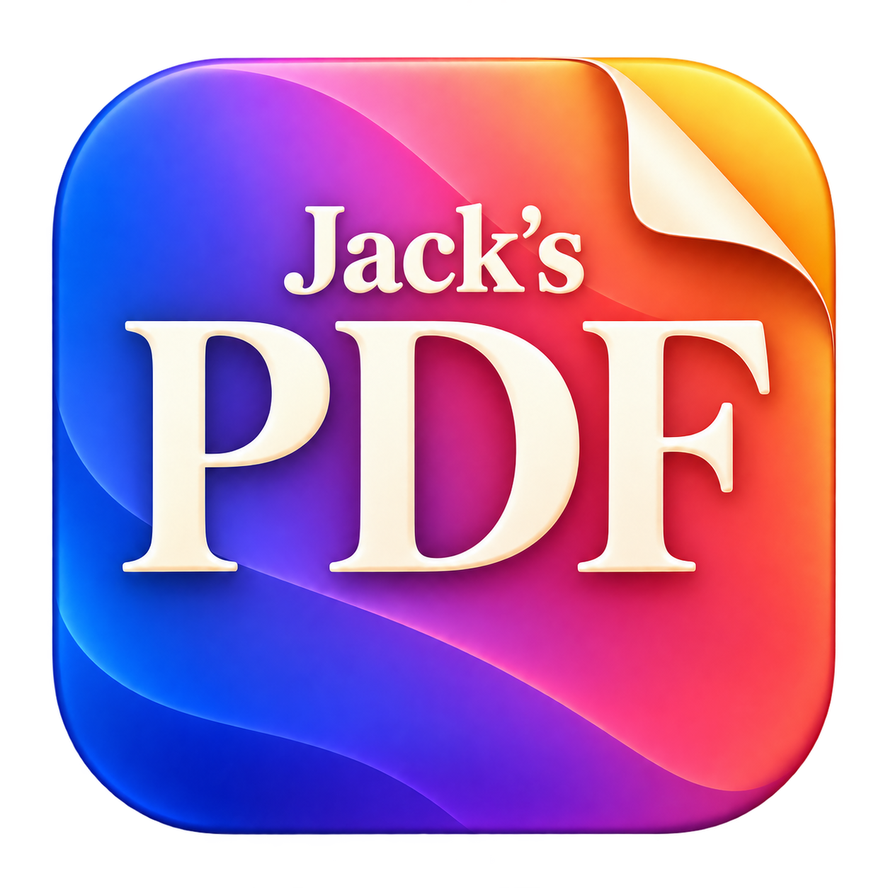

# Jack's PDF



A private, minimalist PDF reader for macOS, created by Nikhil Sharma with OpenAI ChatGPT models.

Version 1.9.1 · Last updated November 5, 2026 · macOS 14 or later

## Download and documentation

[Download version 1.9.1](https://github.com/nikhilrsharma/jacks-pdf/releases/tag/v1.9.1) for Apple silicon, or build from source below. The app requires macOS 14 or later. Extract the ZIP and place **Jack’s PDF.app** in Applications, replacing an older copy if present.

The downloadable app is ad-hoc signed, **not notarized by Apple**. macOS may block a downloaded copy; follow [Apple’s guidance for apps from outside the App Store](https://support.apple.com/102445) only if you trust this release, or build it locally. Do not disable Gatekeeper globally. An Intel release has not been validated.

- [Product requirements document (PDF)](docs/Jacks-PDF-PRD.pdf)
- [Complete app wording review](docs/App-Text-Review.txt)
- [Validation history](VALIDATION.md)
- [Privacy and file safety](SECURITY.md)

## Reading

Open the app and choose **Open PDF…**, or use Finder's **Open With → Jack's PDF**. The app has one window and displays one PDF at a time. Opening another PDF replaces the current one without a rotation warning. Unsaved rotations are discarded only after the next PDF loads successfully; returning to the previous file shows its original orientation.

- Dark interface with Avenir typography and a colourful Jack’s PDF icon. All app-owned text, including the filename, numbers, menus and dialogs, is 13 points with compact native controls, a smaller slider and tighter spacing; native macOS file pickers and system confirmations keep their standard appearance. PDF pages retain their own colours, fonts and layout.
- Continuous vertical pages with subtle separation and smooth scrolling. There is no preview pane.
- **Click a page** to make it active without moving the document or changing the zoom. A thin accent-coloured outline identifies it; the page counter, Rotate and Fit use that page. Scrolling the document resumes normal page tracking. Clicking empty canvas leaves the chosen page active.
- **Up / Down** scroll through the document. **Left / Right** open the previous or next PDF in the same folder. Navigation stops at either end.
- The header groups right-aligned file size and folder position immediately before the page counter, with bold bullet separators before the size and between each field. The metadata fits the widest PDF index in the current folder, keeping its right edges fixed during navigation without reserving unused space for larger folders. The filename uses the available width up to the first metadata bullet. The containing folder path below omits the filename and has its own wider viewport up to the Rotate control; both keep a 12-point gap before their neighbouring element. Long filename and path rows can be scrolled horizontally; hover also reveals their full text.
- Folder navigation needs access to that folder. The app asks through the standard macOS folder picker, showing the filename, full folder path, and an explanation of optional navigation access. Cancel keeps the selected PDF readable without folder navigation. Use Browse folder to approve access later; arrow keys do not repeatedly ask after a decline. Up to 10,000 read-only folder approvals are remembered, with least-recently-used replacement at the limit. It counts visible, readable, regular `.pdf` files in that folder only. Click the **PDF x of y ⌄** counter to choose **Filename (A–Z)** (the default, with `2.pdf` before `10.pdf`) or **Creation date & time**. The global choice is remembered between launches; Left moves to newer PDFs and Right to older PDFs in creation order. Full filesystem creation timestamps are used, not PDF authoring metadata or modification dates. Equal timestamps use natural filename order; unavailable timestamps come last. Changing order preserves the open document, reading position, zoom and rotations, and updates its position in the folder count. Recent history remains ordered by when files were opened. Hidden files, symbolic links, packages and subfolders are excluded. If a folder becomes unavailable, the counter menu offers **Allow Folder Access…** for recovery; a removed or replaced current file remains readable but must be reopened before folder navigation can resume.
- **Fit** uses a plain centred label, with a blue background when active. It adjusts the zoom to the current page's width. Zoom changes never reflow text. Explicitly opening a file starts in Fit mode; navigating between files keeps the chosen zoom mode. Fit remains stable while scrolling and adjusts when the window or fitted page is rotated.
- Manual zoom runs from **20% to 200% in 5% steps**, with a percentage label that follows the slider. Fit can use a scale outside the manual range when the page dimensions require it.
- The header rearranges into two rows in narrower windows, keeping all labels at 13 points. Long filenames scroll within their allotted space.
- Outside full screen, the window uses a fixed **16:10** aspect ratio and fits within the screen with space around it. The title bar displays a small app icon followed by “Jack’s PDF” beside the close and minimize buttons in 13-point Avenir. The green window button is hidden. **View → Full Screen** enters native full screen; **Exit Full Screen** returns to the normal window. View contains no other commands, and there is no Window menu.
- **Jack’s PDF → Shortcuts**, between About and Quit, lists every supported reader and dialog shortcut in a compact, nonresizable modal with no scrollbar. Command-O opens, Shift-Command-S saves a copy, Command-W closes the window, Command-Q quits, Control-Command-F toggles full screen, Command-Plus/Minus zoom, Command-0 selects 100%, Command-9 fits width, Command-R rotates the current page and Option-Command-R rotates all pages. Command-Equal also zooms in. Existing reading, copy, select-all and dialog keys remain; no Find or Save shortcut is added. There is no Hide menu item. Reading arrows and standard dialog Return/Escape behavior remain available.
- **File → Open Recent** keeps the last ten successfully opened PDFs locally, newest first without duplicates, even if persistent permission could not be saved. Valid saved access reopens directly. If a file is unavailable or access is lost, choose **Locate File…**, **Remove from History**, or **Cancel**. Locating and successfully opening a file updates its existing entry; cancellation or a failed open preserves both history and the current PDF. **Clear History** first asks for explicit confirmation, explaining that saved folder access is also removed. Cancel is the default. Confirming clears all saved references and folder approvals and ends active folder navigation; it does not change any PDF or its current rotations. Reopening a recent PDF does not require selecting its folder; use **Browse folder…** when neighbouring-file navigation is needed.

The app offers no printing, sharing, cloud-upload, document-properties, annotation-editing or form-filling commands. Text can be selected and copied when the PDF permits copying. Embedded PDF actions and links are not activated.

## Encrypted local history

Recent-file names, paths and permission bookmarks are stored in an AES-256-GCM encrypted file in the app container’s Application Support folder. The random encryption key is held in the local macOS login Keychain with access restricted to the creating app. The app does not request Keychain cloud syncing. Old preferences are removed only after encrypted migration is verified. A missing key or damaged store is preserved and reported, with no plaintext persistence fallback.

Ad-hoc signed updates may require macOS Keychain approval because the app’s code identity changes. Approve the system prompt only for an update you trust. The app retains ten recent PDFs and up to 10,000 folder approvals; it activates folder access only while needed. These records have no time-based expiry. Clearing is normal logical deletion, not a guarantee of secure erasure from disk or old backups. Encryption does not hide the open app’s UI or protect against an attacker controlling the unlocked app/process.

### When macOS may ask for Keychain approval

At startup, Jack’s PDF reads only its own history-encryption key from the local login Keychain. It holds that key in memory for the session; opening PDFs, approving folders, rotating pages and clearing history do not perform another Keychain read. Clearing history retains the encryption key.

macOS may show an approval or unlock prompt when:

- An update or rebuild changes the app’s ad-hoc signature. Permission granted to an earlier build may not carry over, even after Always Allow.
- You previously chose Allow Once rather than Always Allow. The next app launch may ask again.
- The login Keychain is locked, including when it did not unlock at login, or its password differs from your Mac login password.
- The item’s access controls changed or macOS requires renewed trust after a system update.

A fresh installation normally creates its own key without an access-approval prompt when the login Keychain is unlocked. The app does not request your Apple ID password or access to unrelated passwords. If access is denied, reading remains available, but saved history and folder approvals cannot be loaded or reliably retained; existing encrypted data is preserved. Restart after approving access. If the key is missing while encrypted history exists, the app reports that error rather than silently replacing it.

Apple explains [one-time versus ongoing permission](https://support.apple.com/guide/keychain-access/if-youre-asked-for-access-to-your-keychain-kyca1243/mac), [renewed approval for changed apps](https://support.apple.com/guide/keychain-access/if-a-trusted-app-asks-for-keychain-access-kyca1331/mac), and [locked login Keychains](https://support.apple.com/guide/keychain-access/mac-keychain-password-kyca1242/mac).

## Default PDF app

In Finder, select any PDF and choose **File → Get Info**. Expand **Open with**, select **Jack’s PDF**, then click **Change All** and confirm if prompted. This changes the default for PDFs on this Mac. The app does not change that system preference itself. The app supplies its colourful icon for PDF documents. Finder may show this document icon when Jack’s PDF is the chosen PDF app; content thumbnails and custom file icons can take precedence. Thumbnail settings are left unchanged. See [Apple’s instructions](https://support.apple.com/guide/mac-help/choose-an-app-to-open-a-file-on-mac-mh35597/mac).

## Rotating and saving a copy

Click **Rotate** to turn the current page 90° clockwise. The adjacent arrow offers **Rotate current page** and **Rotate all pages**. Turns use a smooth 600 ms clockwise animation with subtle perspective and shadow movement, respecting the Mac's Reduce Motion setting. Repeated clicks continue clockwise through full turns. Four turns restore the original orientation.

Choose **File → Save As…** after rotating. The standard save dialog starts in the original folder with a suggested new filename. The original file is always protected, including alternate paths and hard links to it. Other existing destination files may be replaced after the standard confirmation. Unsaved rotations prompt **Save As / Discard / Cancel** only when quitting the app or closing its window. Switching PDFs with the arrows, Open or Open Recent, and choosing Close PDF, do not show that warning. These actions discard unsaved rotations without modifying the original.

Rotation uses native PDF page orientation rather than rasterizing the document. Export disables image downsampling and JPEG conversion and preserves native text/vector content. The tests check generated vector/text/form PDFs and a scanned JPEG fixture, including unchanged decoded image pixels and unchanged source bytes. These checks are not a guarantee for every unusual PDF or digital-signature workflow.

Password-protected PDFs can be opened with their password. Rotated export of encrypted PDFs is currently unavailable because the app does not silently remove or weaken their protection. Passwords are not written to history.

The nonresizable About dialog shows its complete contents without scrolling, using compact vertical spacing and the same 13-point text. It starts with the centred app icon and a text divider, followed by the app name and description, creator and model credits, update date and version. Text dividers separate the title, description, credits and tribute, followed by the unchanged photograph of Jack in a small, centred rounded frame. The tribute reads: “In loving memory of Jack, our sweetest companion and forever friend. You are still in our hearts and our lives every day.”

## Build locally

Install Xcode with its macOS SDK, then run from this directory:

```sh
./build.sh
open "build/Jack's PDF.app"
```

The script uses `/Applications/Xcode.app/Contents/Developer` unless `DEVELOPER_DIR` is already set. It builds for the current Mac's architecture (`arm64` on Apple silicon), uses release optimization, and creates a locally ad-hoc-signed app with App Sandbox and the hardened runtime. It does not use an Apple ID, Developer ID certificate, provisioning profile or signing team.

Optional build settings:

```sh
BUILD_DIR="/absolute/path/to/build" ./build.sh
ARCH=arm64 ./build.sh
```

The build output is local and is not notarized for public binary distribution. Nothing is uploaded or published by the build script. Native Swift, AppKit and PDFKit supply the application and rendering; there is no Rust dependency or third-party runtime.

## Tests

```sh
./test.sh
```

This compiles and runs three independent executables in `build/tests` (or `$BUILD_DIR/tests`). `DocumentSupportTests` checks source protection, exports, vector/text/forms, scanned-image preservation, invalid destinations, password handling, history, natural and creation-time folder order, fractional/tied/missing timestamps, preference persistence, renamed/replaced-file identity and snapshot cleanup. `ReaderViewTests` checks native layout, fit and manual zoom, rotation, scrolling, read-only forms/accessibility, and blocked print/action/context-menu paths. The reader checks need a normal macOS graphical login session, and briefly show a generated-document window for animation checks.

`EncryptedLibraryTests` checks migration, authenticated encryption, tampering/wrong-key failures, private file modes, fresh nonces, 10,000-folder capacity, least-recently-used eviction, durable clearing and shortcut mapping. It injects an ephemeral key and never uses the user’s Keychain.

Tests create their own PDF fixtures. They do not use personal documents. They are functional checks, not a performance benchmark or a substitute for trying representative PDFs in the signed app.

## Privacy and source release

See [SECURITY.md](SECURITY.md) for local storage, file access and original-file safeguards. The app contains no telemetry, tracking, network entitlement or automatic updater. The source contains Nikhil Sharma's creator credit; publishing it does not require adding account or signing details.

Released under the [MIT licence](LICENSE). Copyright © 2026 Nikhil Sharma. The repository includes the intended app artwork and memorial photo; camera and editing metadata has been removed from the public photo without changing its decoded pixels.

## Large-file loading

The app uses an APFS copy-on-write snapshot when available, keeping the original separate without reading the entire PDF into RAM. Unsupported filesystems use a background copy with a 1 MiB buffer. PDFKit renders the file-backed snapshot on demand. An optional generated 200 MiB snapshot/isolation test can be run with `PDF_LARGE_SNAPSHOT_TEST=1 ./test.sh`.
